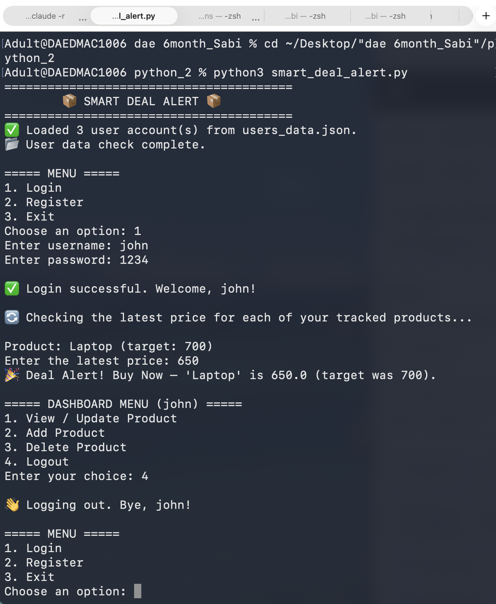

# Python 2 — Smart Deal Alert

A console app that tracks product prices for each user and shows a **Deal Alert** when the price drops to the user's target price.
Users and their tracked products are saved in `users_data.json`.

| File | Contents |
|---|---|
| [smart_deal_alert.py](./smart_deal_alert.py) | The program |
| [users_data.json](./users_data.json) | Sample saved data (demo accounts) |
| [Python_2_Project_Sabitha.pdf](./Python_2_Project_Sabitha.pdf) | Project document: each requirement with code, line numbers and run output |
| [screenshots/program_run.png](./screenshots/program_run.png) | The program running in the Terminal |

**Run:** `python3 smart_deal_alert.py` (from this folder). Demo login: `john` / `1234`.

## Python concepts used

| Concept | Where in `smart_deal_alert.py` |
|---|---|
| Constant | Line 34 — `DATA_FILE = "users_data.json"` |
| if-else | `check_deal()` lines 120–129 — "Deal Alert! Buy Now" if the price is at or below the target, else "Still Too Expensive" |
| while loop | Line 143 — `while attempts > 0:` gives the user three login attempts |
| for loop | Line 187 — `for product in tracked_products:` checks the latest price of every product |
| Functions with arguments that return a value | `find_product_by_id(product_id)` (line 113) returns the product; `check_deal(product)` (line 120) returns `True`/`False`; `get_positive_number(prompt)` (line 94) returns the number entered |
| List manipulation | Add: `tracked_products.append(new_product)` (line 258); update one element: `product["last_price"] = …` (lines 189, 237); delete: list rebuilt without the product (line 282); loop over each element (lines 187, 207) |
| File read and write | Read: `json.load(file)` (line 49); write: `json.dump(all_users, file, indent=2)` (line 87) |
| Exception handling | `load_all_users()` lines 46–64 — `try` reads the file; `except FileNotFoundError` creates sample accounts; `except json.JSONDecodeError` handles a damaged file; `else` confirms how many accounts were loaded; `finally` always prints "User data check complete." Also `try`/`except ValueError` for number input (lines 97, 221, 271) |

The Semester 1 version of this program is in [semester_1/02_python_1/05_Smart_Deal_Alert_Final](../semester_1/02_python_1/05_Smart_Deal_Alert_Final/).
